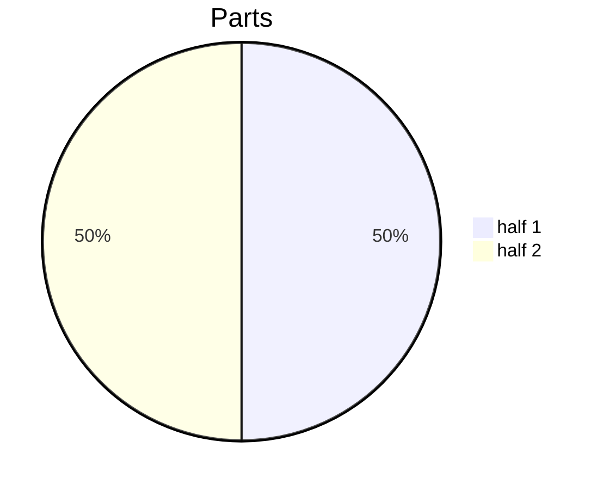
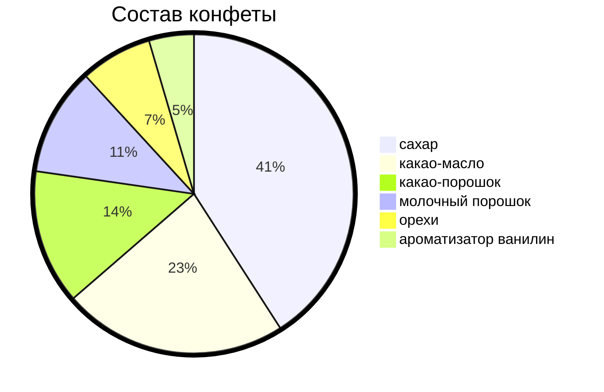

-----------asd

---

///

## XYCHART

```py
const values = [[],[],[],[],[],[],[]];
for (let i - 0; i < $0.childNodes.length; i++>) {
    if (i < 3) continue;
    const row = $0.childNodes.item(i);
    for (let j = 1; j < row.childNodes.length; j++) {
        const td = child.childNodes.item(j);
        values[j - 1].push(Number(td.textContent))
    }
}
values.map(JSON.stringify).forEach(arr => console.log(arr))
```

---
config:
    themeVariables:
        xyChart:
            plotColorPalette: '#000000, #0000ff, #00ff00, #ff0000, #ffffff'
        xAsis:
            showAxisLine: true
---
xychart
    title "weather cheb"

    x-axis "Date" [1,2,3,4,5,6,7,8,9,10,11,12,13,14,15,16,17,18,19,20,21,22,23,24,25,26,27,28,29,30,31]
    y-axis "*C" -10 --> 30
    line "Minimum" [14.6, 17.1, 16.9, 14.8, 14.6, 15, 16.7, 17.9, 16.2, 13.3, 11.9, 12.5, 11.5, 8.7, 8.8, 9.9, 9.9, 10.8, 11.6, 14.9, 9.5, 12.8, 13, 16.6, 10.8, 10.4, 12.1, 5.2, 6.4, 5.8, 9.7]
    line "Average" [19.2, 22.7, 22.3, 20, 20.1, 21.3, 22, 21.6, 18.9, 17.7, 18.8, 17.2, 14.4, 9.9, 10, 11, 13.1, 16.2, 18.6, 17.2, 15.2, 18, 18.9, 20, 16.4, 14.2, 14.2, 11.5, 12.1, 13, 13.9]
    line "Maximum" [25, 27.3, 26, 24.3, 25, 27.4, 28.7, 25.8, 24.7, 22.4, 24.6, 24, 17.8, 14.1, 12.6, 13.1, 15.2, 21.7, 26.6, 24.6, 23.1, 22.2, 24.8, 26.3, 21.8, 18.3, 16.9, 16.4, 17, 18.4, 18.5]
---