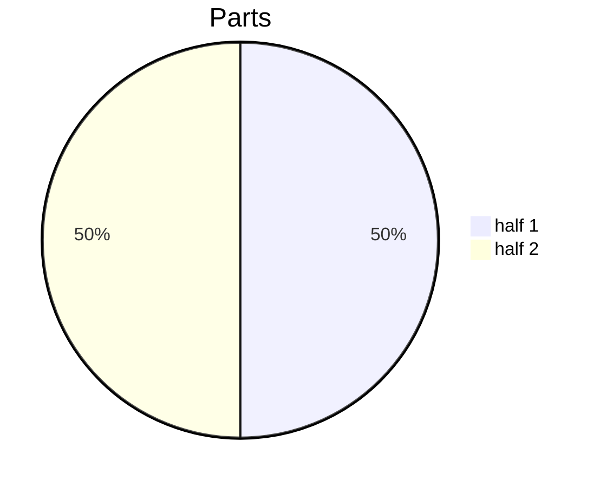
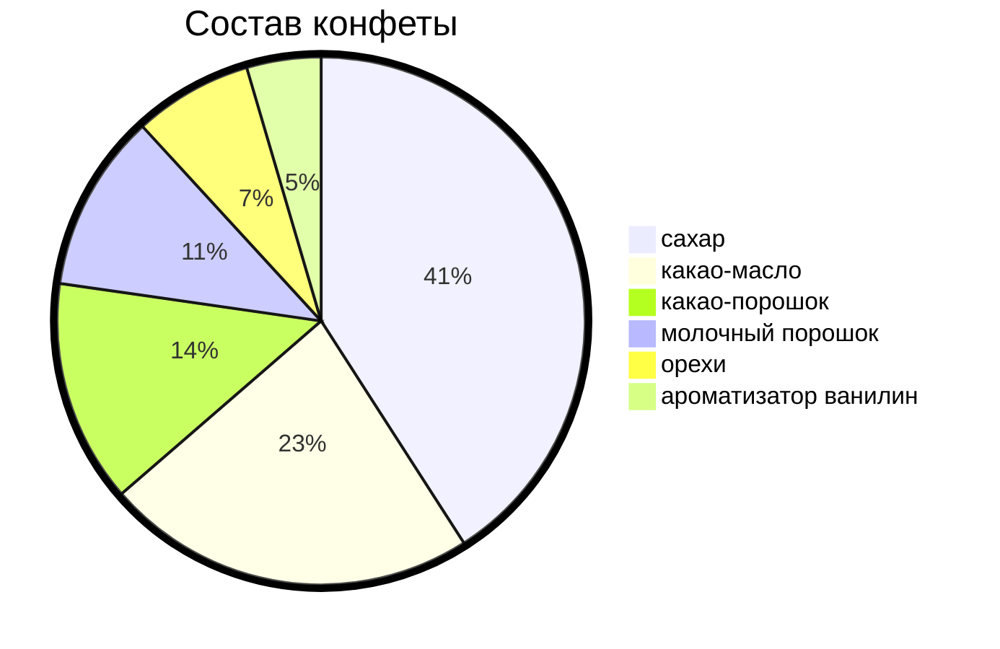
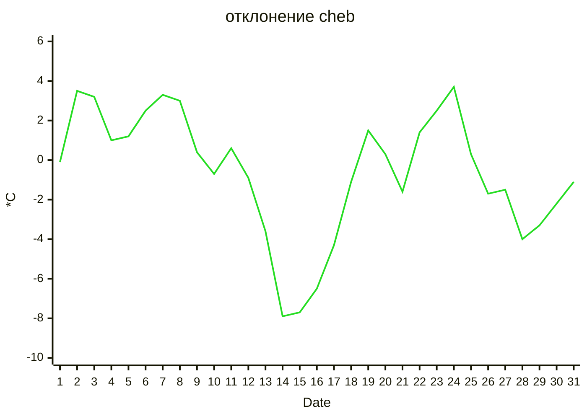
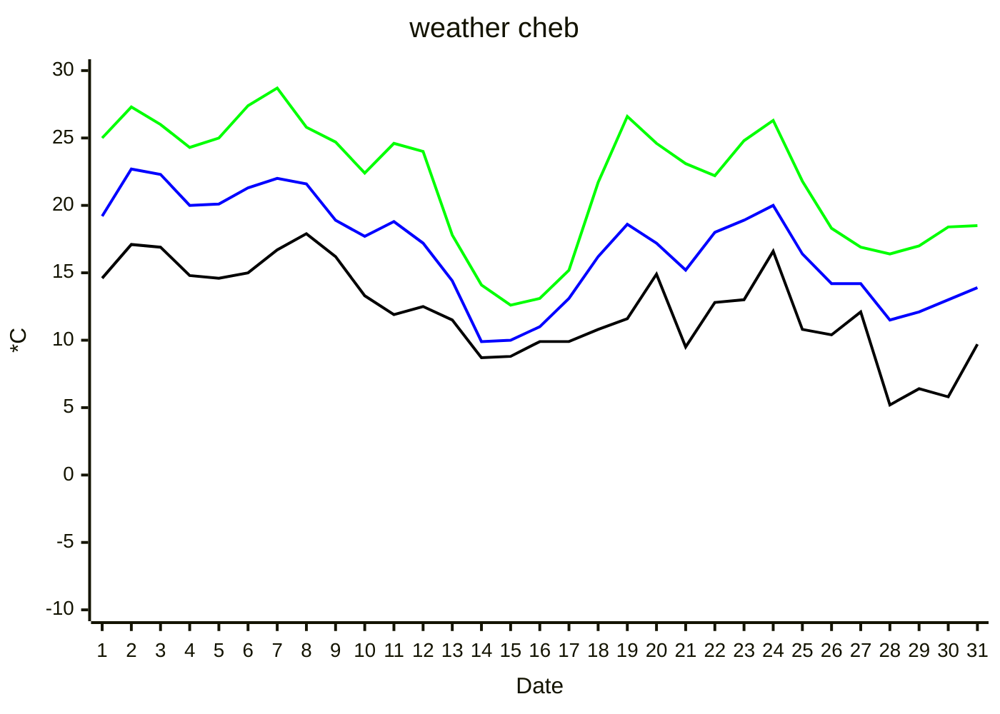
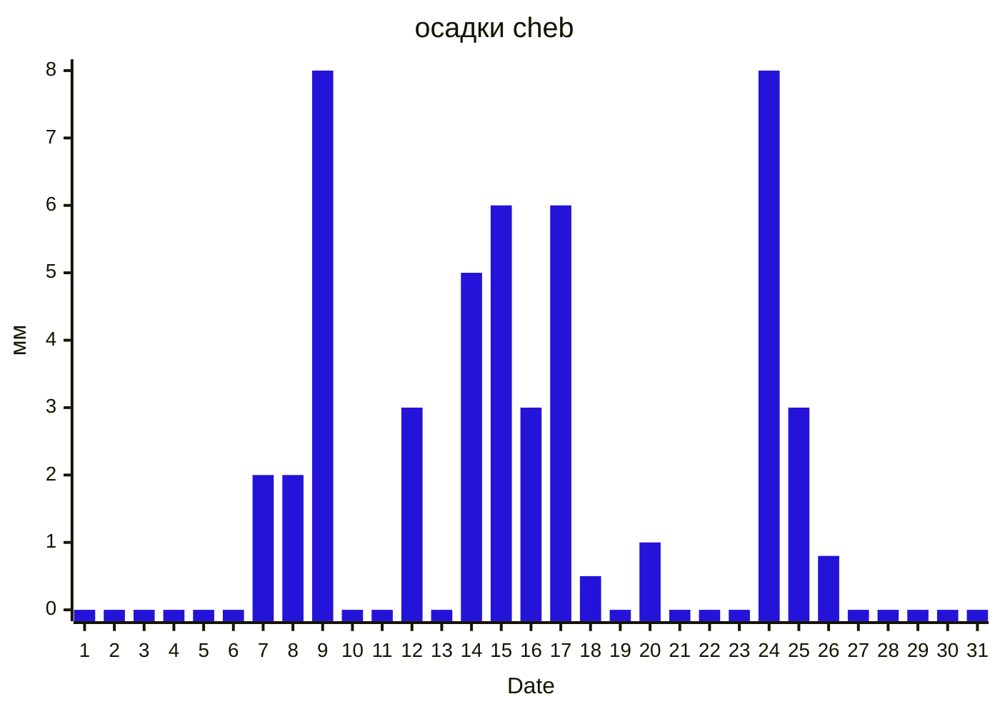

---

```py
const tbody = document.querySelector("#arch_table table>tbody")
const values = [[], [], [], [], [], [], []];
for (let i = 0; i < tbody.childNodes.length; i++) {
    if (i < 3) continue;
    const row = tbody.childNodes.item(i);
    for (let j = 1; j < row.childNodes.length; j++) {
        const td = row.childNodes.item(j);
        values[j - 1].push(Number(td.textContent))
    }
}
values.map(JSON.stringify).forEach(arr => console.log(arr))

```







 [1,2,3,4,5,6,7,8,9,10,11,12,13,14,15,16,17,18,19,20,21,22,23,24,25,26,27,28,29,30,31]
 [14.6,17.1,16.9,14.8,14.6,15,16.7,17.9,16.2,13.3,11.9,12.5,11.5,8.7,8.8,9.9,9.9,10.8,11.6,14.9,9.5,12.8,13,16.6,10.8,10.4,12.1,5.2,6.4,5.8,9.7]
 [19.2,22.7,22.3,20,20.1,21.3,22,21.6,18.9,17.7,18.8,17.2,14.4,9.9,10,11,13.1,16.2,18.6,17.2,15.2,18,18.9,20,16.4,14.2,14.2,11.5,12.1,13,13.9]
 [25,27.3,26,24.3,25,27.4,28.7,25.8,24.7,22.4,24.6,24,17.8,14.1,12.6,13.1,15.2,21.7,26.6,24.6,23.1,22.2,24.8,26.3,21.8,18.3,16.9,16.4,17,18.4,18.5]
 [-0.1,3.5,3.2,1,1.2,2.5,3.3,3,0.4,-0.7,0.6,-0.9,-3.6,-7.9,-7.7,-6.5,-4.3,-1.1,1.5,0.3,-1.6,1.4,2.5,3.7,0.3,-1.7,-1.5,-4,-3.3,-2.2,-1.1]
 [0,0,0,0,0,0,2,2,8,0,0,3,0,5,6,3,6,0.5,0,1,0,0,0,8,3,0.8,0,0,0,0,0]
 [0,0,0,0,0,0,0,0,0,0,0,0,0,0,0,0,0,0,0,0,0,0,0,0,0,0,0,0,0,0,0]
