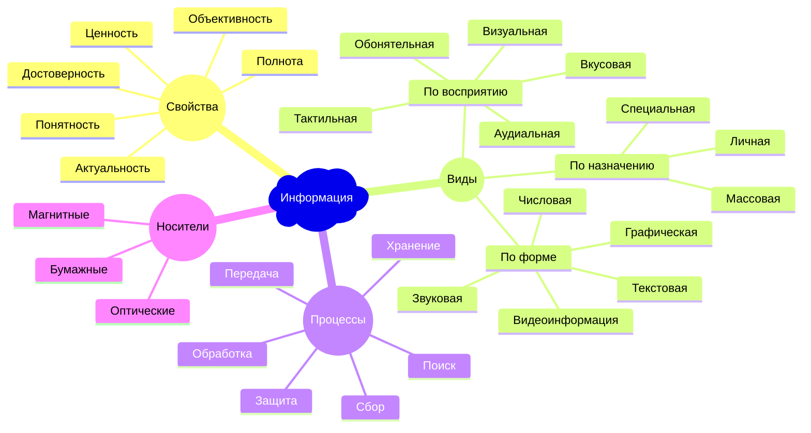

```mermaid
gantt
    dateFormat YYYY-MM-DD
    excludes weekends

    section Main flow

    Completed task :done, des1, 2026-01-06, 2026-01-08
    Active task :active, des2, 2026-01-09, 3d
    Future task : des3, after des2, 5d
    Future task2 : des4, after des3, 5d

    section Critical tasks

    Completed task in the critical line :crit, done, 2026-01-06, 24h
    Implement solution :crit, done, after des1, 2d
    Create tests : crit, active, 3d
    Future task in critical line : crit, 5d
    Create tests 2 : 2d
    Release : des5, after des4, 2d
    Functionality added :milestone, isadded, 2026-01-25, 0d

    section Documentation

    Describe syntax :active, a1, after des1, 3d
    Add diagram :a2, after a1, 20h
    Add another diagram :doc1, after a1, 48h
    Release docs :doc_release, after a1, doc1, a2, 48h

```