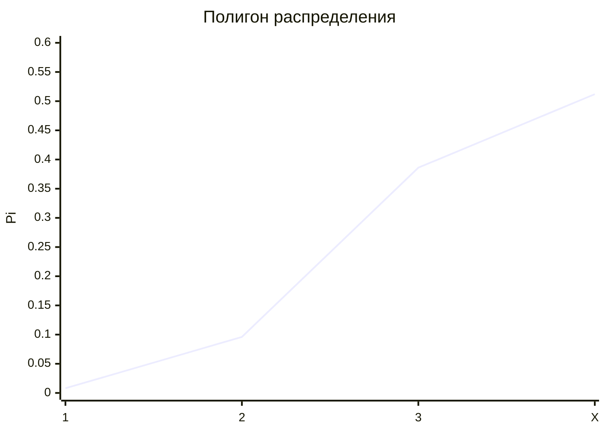

# Понятие Биномиального раcпределения
**Определение** - *Дискретная случайная величина $X$ имеет ***биномиальный закон распределения*** с параметром $n$ и $p$, если она принимает значения $0, 1, 2,..., m,..., n$ с вероятностями*

$$P(X = m) = C^m_n p^m q^{n-m}$$

где $ 0 < p < 1, q = 1 - p $

Следовательно биномиальный закон распределения представляет собой закон распределения числа $X=m$ наступлений события $A$ и $n$ независимых испытаний в каждом из которых оно может произойти с одной и той же вероятностью $p$  
Ряд распределения биномиального закона имеет вид:

| $x_i$ | 0 | 1 | 2 | ... | $m$ | ... | $n$ |
| :---: | :---: | :---: | :---: | :---: | :---: | :---: | :---: |
| $p_i$ | $q^n$ | $C^1_n p q^{n-1}$ | $C^2_n p^2 q^{n-2}$ | ... | $C^m_n p^m q^{n-m}$ | ... | $p^n$ |

**Теорема.** Математическое ожидание случайной величины $X$, распределенной по биномиальному закону,  
$$M(X)=np$$

## Задачи...
### 1. Вероятность правильного оформления накладной при передаче продукции равна $0,8$ какова вероятность того, что из $3$ накладных только $2$ оформлены правильно?
$p=0,8$  
$q=1-0,8=0,2$  
$n=3$  
Решение по формуле Бернули:    
$P_3(2)=C^2_3p^2q^{3-1}=3*0,8^2*0,2^1=3*0,64*0,2=0,384$  
Изменим постановку вопроса этой задачи:  
* *Составить закон распределения(ЗР) дискретной случайной велечины - числа правильно оформленных накладных*  

Решение:  
$n=3$  
$p=0,8$  
$q=0,2$  

|$X$|$0$|$1$|$2$|$3$|
| :---: | :---: | :---: | :---: | :---: |
|$p$|$0,008$|$0,0096$|$0,386$|$0,512$|  

* $P_0(X=0)=0,2*0,2*0,2=0,008$  
* $P_1(X=1)=C^1_3*0,8^2*0,2^{3-1}=0,8*0,2*0,2=0,096$  
* $P_2(X=2)=C^2_3*0,8^1*0,2^2=3*0,8^2*0,2^1=3*0,64*0,2=0,384$  
* $P_3(X=3)=0,8*0,8*0,8=0,512$  

Контроль: $\sum_{i=1}^{4} p_i = 0,008+0,096+0,384=0,512=1$

$M(X)=0*0,008+1*0,096+2*0,384+3*0,512=2,4$  
$M(X^2)=0^2*0,008+1^2*0,096+2^2*0,384+3^2*0,512=6,24$  
$D(X)=M(X^2)-(M(X))^2=6,24-(2,4)^2=0,48$  

Поскольку данная случайная велечина имеет биномиальное распределение (применили формулу Бернули), то числовые характеристики можно найти по формулам:

$M(X)=n*p=3*0,8=2,4$  (Математическое ожидание)    
$D(X)=n*p*q=3*0,8*0,2=0,48$  (Дисперсия)  

### Задачи дальше....
Строим полигон или многоугольник распределения

### Дальше идем...
### Геометрическое распределение характеристики
*Определение - Дискретная случайная велечина $X=m$ имеет **геометрическое распределение** с параметром $p$, если она принимает значения $1,2,...,m...$ (бесконечное, но счетное множество значений) с вероятностями*  
$$P(X=m)=pq^{m-1}$$
где $0<p<1, q=1-p.$  
Ряд геометрического распределения случайной величины имеет вид:  
|$x_i$|$1$|$2$|$3$|$...$|$m$|$...$|
|:---:|:---:|:---:|:---:|:---:|:---:|:---:|
|$p_i$|$p$|$pq$|$pq^2$|$...$|$pq^{m-1}$|$...$|  

Случайная величина $X=m$, имеющая геометрическое распределение, представляет собой число $m$ испытаний, проведенных по схеме Бернулли, с вероятностью $p$ наступления события в каждом испытании до первого положительного исхода.  
**Теорема.** Математическое ожидание случайной велечины $X$, имеющей геометрическое распределение с параметром $p$,  
$$M(X)=\frac{1}{p},$$
а ее дисперсия  
$$D(X)=\frac{q}{p^2},$$
где $q=1-p.$