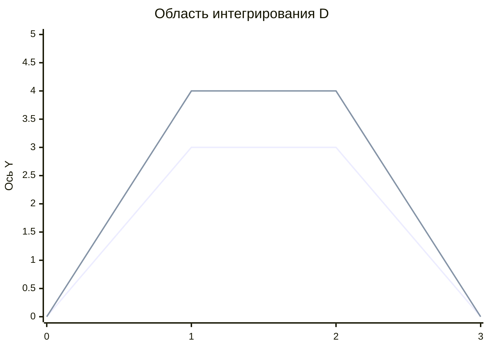

### Двойные интегралы
*Двойным интегралом* от непрерывной функции $f(x,y),$ распространенным на ограниченную замкнутую область $D$ плоскости $XOY$, называется предел соответсвующей двумерной интегральной суммы  
$$\lim_{\substack {max \Delta x_i \to 0 \\ max \Delta y_k \to 0}}
\sum_i \sum_k f(x_i, y_k)\Delta x_i \Delta y_k = 
\iint\limits_{(D)}f(x,y)dxdy,
$$
где $\Delta xi=x_i-x_{i-1}, \Delta y_k=y_k-y_{k-1}$ и сумма распорстраннена на те значения $i$ и $k$, для которых точки $(x_i, y_k)$ принадлежит области $D$.  
Пусть область интегрирования $D$ ограничена слева и справа прямыми $x=a$ и $x=b$  $(a < b)$, а снизу и сверху непрерывными кривыми $y=\phi_i(x)$ и $y=\phi_2(x)$ $(\phi_2(x)\geq\phi_1(x))$ Тогда двойной интеграл сводится к повторному интегралу по формуле  
$$\iint\limits_{(D)}f(x,y)dxdy=\int_a^b dx \int_{\phi_i(x)}^{\phi_2(x)} dy,$$

где при вычислении $\int_{\phi_1(x)}^{\phi_2(x)} f(x,y)dy$ велечину $x$ пологают постоянной.

### дальше крч...
$\int (e^x+3)dx$ - неопределенный  
$\int_1^2 (4x^3+\frac{1}{x})dx$ - определенный  

$\int^{+\infty}_1 \frac{1}{x}dx$ - несобственный  
$\int_{-\infty}^0 e^x dx$ - тоже несобственный    

### дальше...
$\iint_D (x+y)dxx,$ где область $D$ ограниченная линиями  
$$\begin{cases}
1 \geq x \geq 2 \\
3 \geq y \geq 4
\end{cases}$$  

### правило интегрирования
$\int(f\pm g)dx = \int fdx\pm \int gdx$  
$\int cdx=c*\int dx$

### дальше какая то шляпа...
$\iint_D (x+y)dxdy=\int_1^2 dx \int_3^4 (x+y)dx$  
$\int_3^4 (x+y)dy = \int_3^4 xdy+ \int_3^4 ydy$, где $x=const$  

### задачки...
$\iint_D (x+y)dxdy= \int_1^2 dx \int_3^4 (x+y) dy$ ---------- $()`=y$  
$\int_3^4 (x+y)dy = \int_3^4 xdy + \int_3^4 ydy= x\int_3^4 dy + \frac{y^{1+1}}{1+1} \big|_3^4 = ...$  

$\int_0^2dy\int_0^1(x^2+2y)dx=$